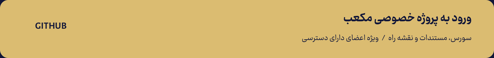
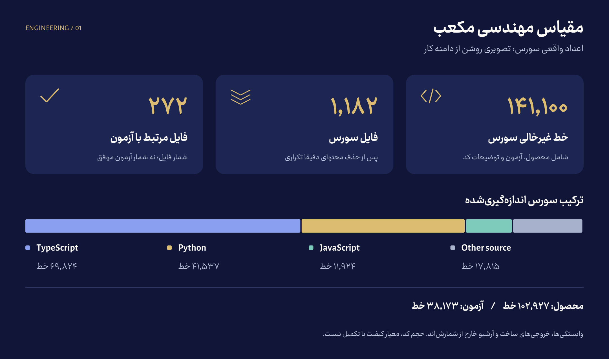
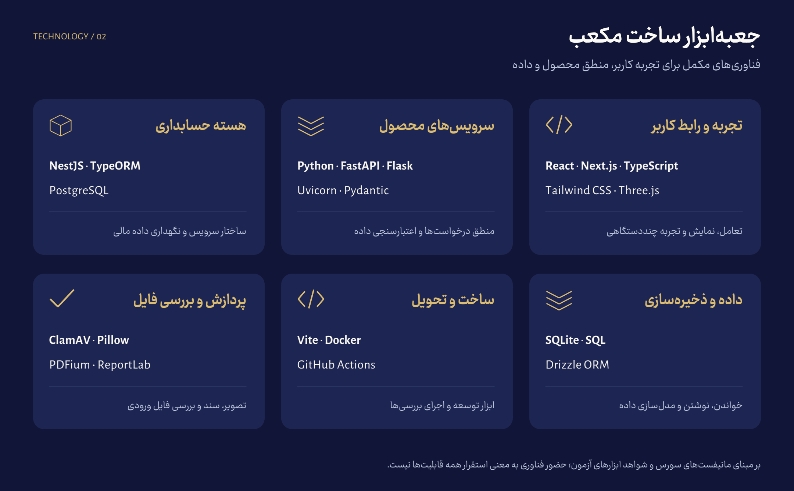
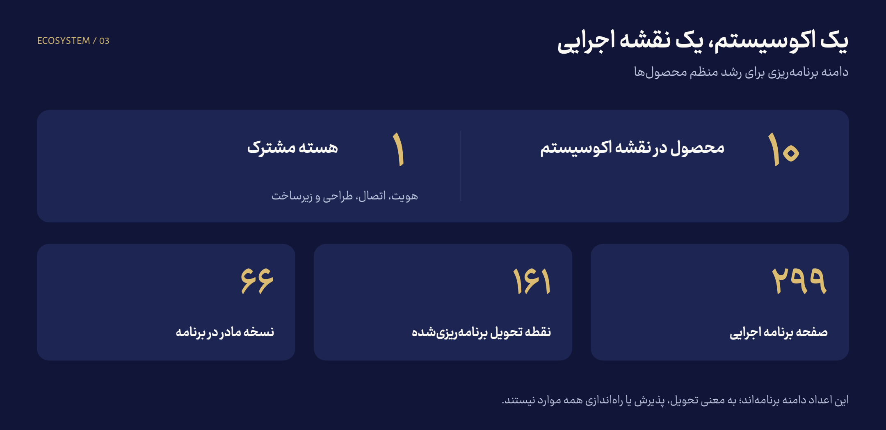
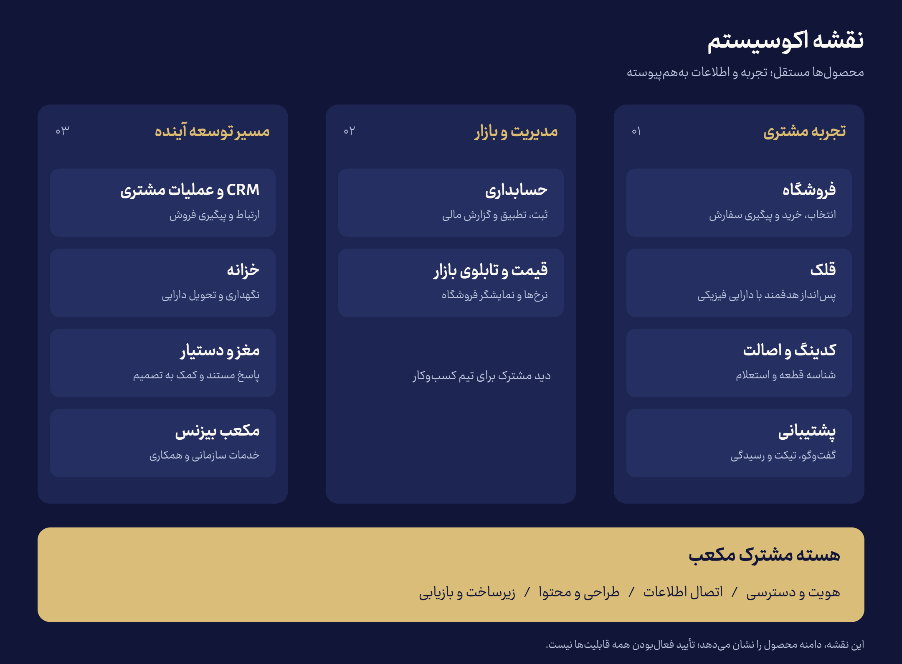
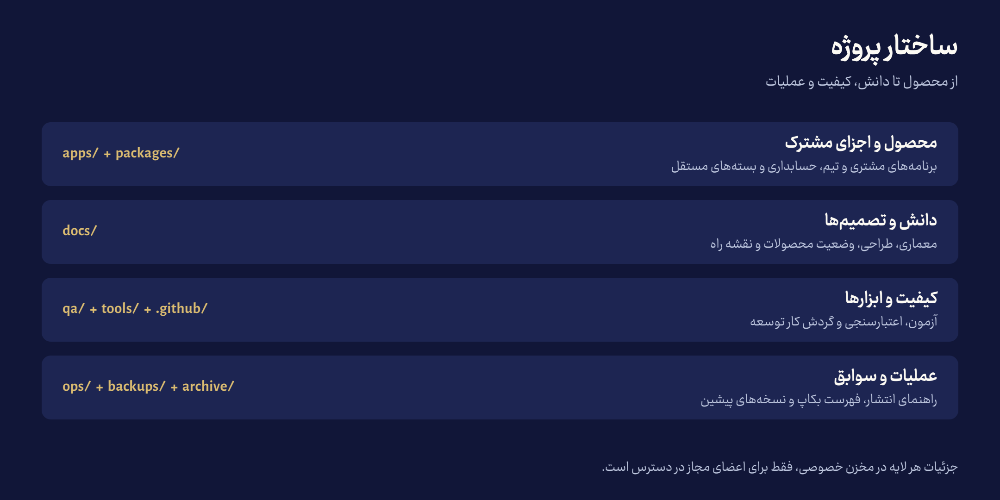

<div align="center">


[**وب‌سایت مکعب**](https://mokaab.gold) · [**پروژهٔ خصوصی**](https://github.com/dewhaloper/mokaab) · [**نقشهٔ راه — اعضای تیم**](https://github.com/dewhaloper/mokaab/tree/main/docs/planning) · [**راهنمای فنی — اعضای تیم**](https://github.com/dewhaloper/mokaab/blob/main/docs/README-TECHNICAL.md)

</div>

[](https://github.com/dewhaloper/mokaab)

> برای ورود به پروژهٔ خصوصی، با حساب GitHub دارای دسترسی وارد شوید. این لینک مجوز تازه‌ای ایجاد نمی‌کند؛ برای حساب فاقد دسترسی ممکن است صفحهٔ ۴۰۴ نمایش داده شود.

## یک برند، یک تجربه، محصول‌های به‌هم‌پیوسته

مکعب مسیر **انتخاب، خرید و پس‌انداز در طلا، نقره و مس فیزیکی** را به اصالت کالا، پشتیبانی و مدیریت مالی متصل می‌کند. مشتری باید بداند چه می‌خرد و درخواستش در چه مرحله‌ای است؛ تیم کسب‌وکار باید بتواند همان مسیر را دقیق و منظم پیگیری کند.

## مکعب در مقیاس

پشت تجربهٔ سادهٔ مشتری، مجموعه‌ای از رابط‌ها، سرویس‌ها، مدل‌های داده و مسیرهای آزمون قرار دارد. اندازه‌گیری سورس ثبت‌شده، **۱۴۱٬۱۰۰ خط غیرخالی در ۱٬۱۸۲ فایل** را نشان می‌دهد؛ **۲۷۲ فایل مرتبط با آزمون** نیز در همین مجموعه قرار دارند.



| ترکیب سورس | خط غیرخالی |
|---|---:|
| TypeScript | ۶۹٬۸۲۴ |
| Python | ۴۱٬۵۳۷ |
| JavaScript | ۱۱٬۹۲۴ |
| CSS، SQL، PHP، HTML و اسکریپت‌های پوسته | ۱۷٬۸۱۵ |
| **مجموع محصول و آزمون** | **۱۴۱٬۱۰۰** |

<details>
<summary><strong>مبنای آمار و روش شمارش</strong></summary>

این تصویر آماری از نسخهٔ `0604b3438ce0` مخزن خصوصی، اندازه‌گیری‌شده در ۱۱ اکتبر ۲۰۲۶ است. فقط فایل‌های سورس ثبت‌شده در `apps/` و `packages/` بررسی شده‌اند. خطوط خالی حذف شده‌اند؛ توضیحات داخل کد در شمارش باقی مانده‌اند. سهم فایل‌های محصول **۱۰۲٬۹۲۷ خط** و سهم فایل‌های مرتبط با آزمون **۳۸٬۱۷۳ خط** است.

وابستگی‌ها، آرشیو بیرون از این مسیرها، تصاویر، بکاپ‌ها، فایل‌های قفل وابستگی، پوشه‌های شناخته‌شدهٔ خروجی ساخت و بستهٔ کامپایل‌شدهٔ فرانت‌اند قلک وارد شمارش نشده‌اند. فایل‌های فشرده و فایل‌هایی با خط بیش از ۲٬۰۰۰ نویسه نیز کنار گذاشته شده‌اند. محتوای دقیقاً یکسان پس از یکسان‌سازی پایان خط، فقط یک بار شمرده شده است؛ نسخه‌های متفاوت داخل پوشه‌های سورس ممکن است همچنان حضور داشته باشند.

تعداد فایل آزمون، **تعداد تست موفق یا درصد پوشش آزمون نیست**. این آمار اندازهٔ سورس است و به‌تنهایی کیفیت، میزان کد دست‌نویس یا تکمیل عملیاتی محصولات را ثابت نمی‌کند.

</details>

## فناوری‌هایی که این تجربه را می‌سازند



| لایه | فناوری‌های موجود در سورس و ابزارهای بررسی |
|---|---|
| رابط و تعامل | React، Next.js، TypeScript، Tailwind CSS، Three.js |
| سرویس‌های محصول | Python، FastAPI، Flask، Uvicorn، Pydantic |
| حسابداری | NestJS، TypeORM، PostgreSQL |
| داده | SQLite، SQL، Drizzle ORM |
| ساخت و تحویل | Vite، Docker، GitHub Actions |
| فایل و سند | ClamAV، Pillow، PDFium، ReportLab |

این فهرست از مانیفست‌های پروژه و شواهد ابزارهای آزمون استخراج شده است؛ وضعیت استقرار هر سرویس جداگانه بررسی می‌شود.

## دامنهٔ برنامهٔ اجرایی



نقشهٔ اکوسیستم **۱۰ محصول و یک هستهٔ مشترک** را پوشش می‌دهد. برنامهٔ اجرایی ثبت‌شده، **۲۹۹ صفحه، ۱۶۱ نقطهٔ تحویل و ۶۶ نسخهٔ مادر برنامه‌ریزی‌شده** دارد. این اعداد دامنهٔ برنامه را توصیف می‌کنند؛ تعداد نسخه‌های منتشرشده یا قابلیت‌های تحویل‌گرفته‌شده نیستند. [جزئیات برنامه برای اعضای تیم](https://github.com/dewhaloper/mokaab/tree/main/docs/planning).

## نقشهٔ محصولات



| تجربهٔ مشتری | مدیریت و بازار | مسیر توسعهٔ آینده |
|---|---|---|
| فروشگاه؛ انتخاب و خرید | حسابداری؛ ثبت و تطبیق | CRM؛ ارتباط و پیگیری مشتری |
| قلک؛ پس‌انداز هدفمند | قیمت و تابلو؛ مدیریت و نمایش نرخ | خزانه؛ نگهداری و تحویل |
| کدینگ و اصالت؛ شناسه و استعلام | هستهٔ مشترک؛ هویت و اتصال | دستیار؛ پاسخ مستند |
| پشتیبانی؛ تیکت و گفت‌وگو | طراحی، محتوا و زیرساخت | بیزنس؛ خدمات سازمانی |

نقشه، دامنهٔ اکوسیستم را نشان می‌دهد. اولویت جاری، درست‌کارکردن فروشگاه، قلک، کدینگ و استعلام، حسابداری و مسیر مشتری تا رسیدگی مدیر است. توسعهٔ امکانات پیشرفته به آمادگی مراحل قبلی وابسته است.

## ساختار پروژه



<details>
<summary><strong>مشاهدهٔ ساختار پوشه‌ها و نقش هر بخش</strong></summary>

```text
mokaab/
├── apps/          برنامه‌های مشتری و تیم کسب‌وکار
├── packages/      حسابداری و بسته‌های مستقل
├── docs/          معماری، طراحی، وضعیت و نقشهٔ راه
├── qa/            آزمون و شواهد پذیرش
├── tools/         ابزارهای توسعه و اعتبارسنجی
├── .github/       گردش کار مخزن
├── ops/           راهنمای عملیات و انتشار
├── backups/       فهرست و رسید پشتیبان‌ها
└── archive/       سوابق و نسخه‌های پیشین
```

این ساختار متعلق به مخزن خصوصی است. مخزن عمومی فقط معرفی و تصاویر همین صفحه را نگهداری می‌کند.

</details>

## میز کار تیم مکعب

پیوندهای زیر به **مخزن خصوصی** می‌روند و برای اعضای دارای دسترسی‌اند:

| بخش | ورود مستقیم |
|---|---|
| فروشگاه | [سورس و راهنما](https://github.com/dewhaloper/mokaab/tree/main/apps/storefront) |
| قلک | [سورس و زمینهٔ محصول](https://github.com/dewhaloper/mokaab/tree/main/apps/qolak) |
| کدینگ و استعلام | [پنل صدور](https://github.com/dewhaloper/mokaab/tree/main/apps/verify-admin) · [استعلام عمومی](https://github.com/dewhaloper/mokaab/tree/main/apps/verify-public) |
| حسابداری | [بستهٔ حسابداری](https://github.com/dewhaloper/mokaab/tree/main/packages/accounting) |
| پشتیبانی | [سورس و مستندات](https://github.com/dewhaloper/mokaab/tree/main/apps/support) |
| همهٔ حوزه‌ها | [فهرست مستندات](https://github.com/dewhaloper/mokaab/blob/main/docs/README.md) · [معماری](https://github.com/dewhaloper/mokaab/tree/main/docs/architecture) · [برنامهٔ اجرایی](https://github.com/dewhaloper/mokaab/tree/main/docs/planning) |

## وضعیت و محرمانگی

سورس و مستندات در مخزن خصوصی گردآوری شده‌اند و آزمون‌های فنی و یکپارچه برای بخش‌هایی از محصول ثبت شده است. **پذیرش کامل عملیاتی، بازیابی همهٔ سرویس‌ها و راه‌اندازی نهایی مالی هنوز مراحل باقی‌مانده دارند.** این معرفی اعلام تکمیل همهٔ محصولات نیست.

معرفی و گرافیک این صفحه عمومی‌اند. کدها، مستندات داخلی، داده‌های مشتری و جزئیات پشتیبان‌ها عمومی نشده‌اند. برای دیدن معرفی نیازی به حساب GitHub نیست؛ برای دسترسی به پروژه، مجوز تیم لازم است.

---

<div align="center">

**مکعب — تجربهٔ روشن برای مشتری، مدیریت منظم برای کسب‌وکار**

[مشاهدهٔ وب‌سایت](https://mokaab.gold) · [ورود اعضای تیم به پروژه](https://github.com/dewhaloper/mokaab)

</div>
