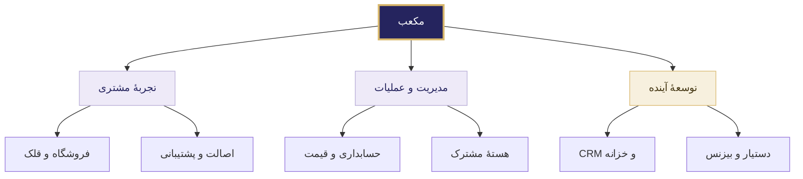

# مکعب | Mokaab

### یک تجربهٔ یکپارچه برای خرید، پس‌انداز و مدیریت فلزات گران‌بها

**طلا · نقره · مس**

[وب‌سایت مکعب](https://mokaab.gold)

---

## مکعب چیست؟

مکعب مجموعه‌ای از محصولات مرتبط برای مشتریان و تیم کسب‌وکار است؛ از انتخاب و خرید کالای فیزیکی و پس‌انداز هدفمند تا پیگیری سفارش، استعلام اصالت و مدیریت مالی. هدف، تجربه‌ای روشن برای مشتری و اطلاعات قابل پیگیری برای مدیران است.

این صفحه معرفی عمومی و مدیریتی پروژه است. وجود یک محصول در نقشهٔ مکعب، به معنی فعال‌بودن همهٔ امکانات آن نیست؛ دامنهٔ جاری و برنامهٔ توسعه در ادامه تفکیک شده‌اند.

## نقشهٔ محصولات

| محصول | نقش در تجربهٔ مکعب |
|---|---|
| **فروشگاه مکعب** | معرفی و انتخاب محصول، خرید، پیگیری سفارش و رسیدگی مدیر |
| **قلک مکعب** | پس‌انداز هدفمند مبتنی بر دارایی فیزیکی و برنامه‌ریزی برای هدف‌های مشتری |
| **کدینگ و استعلام اصالت** | شناسهٔ قطعه، مدیریت صدور و بررسی اصالت کالا |
| **حسابداری مکعب** | ثبت و تطبیق رویدادهای مالی و گزارش‌های مدیریتی |
| **قیمت و تابلوی بازار** | مدیریت نرخ‌ها و نمایش قیمت برای وب، موبایل و نمایشگر فروشگاه |
| **پشتیبانی مکعب** | تیکت، گفت‌وگو و پیگیری درخواست‌های مشتری و کارکنان |
| **عملیات مشتری و CRM** | برنامهٔ توسعهٔ ارتباط با مشتری و هماهنگی پیگیری‌های فروش |
| **خزانه مکعب** | برنامهٔ توسعهٔ مدیریت موجودی فیزیکی، نگهداری و تحویل |
| **مغز و دستیار مکعب** | مسیر توسعهٔ پاسخ‌گویی مستند و کمک به تصمیم‌گیری |
| **مکعب بیزنس** | مسیر توسعهٔ خدمات سازمانی و همکاری‌های تجاری |

**هستهٔ مشترک، طراحی و محتوا، و زیرساخت** اجزای پیونددهندهٔ این محصولات‌اند؛ هویت کاربران، دسترسی‌ها، کیفیت تجربه و اتصال اطلاعات باید در این لایه‌ها هماهنگ باشند.

## اولویت اجرایی

تمرکز مرحلهٔ جاری بر درست‌کارکردن فروشگاه، قلک، کدینگ و استعلام، حسابداری و اجزای مشترک آن‌هاست. تکمیل مسیر مشتری و رسیدگی مدیر به سفارش، پیش از گسترش قابلیت‌های پیشرفته قرار دارد. توسعهٔ CRM، خزانه، دستیار و خدمات بیزنس در مراحل بعد و متناسب با آمادگی عملیاتی دنبال می‌شود.

هماهنگ‌سازی سورس و مستندات در مخزن خصوصی انجام شده و برای بخش‌هایی از محصول، آزمون‌های فنی و یکپارچه ثبت شده است. پذیرش کامل عملیاتی، بازیابی همهٔ سرویس‌ها و راه‌اندازی نهایی مالی همچنان نیازمند تکمیل مراحل مربوط‌اند. این صفحه اعلام پایان توسعه یا تأیید کامل بهره‌برداری نیست.

## معیارهای کیفیت

- تجربهٔ فارسی، راست‌به‌چپ و قابل استفاده روی موبایل، تبلت و دسکتاپ.
- نمایش روشن قیمت، وزن، وضعیت سفارش و اطلاعات مورد نیاز مشتری.
- حفظ سوابق و امکان پیگیری عملیات، با دسترسی متناسب با نقش کارکنان.
- انتشار مرحله‌ای همراه با آزمون، بازبینی و امکان بازیابی.

## دسترسی و محرمانگی

این معرفی برای مشاهده و ارائهٔ عمومی آماده شده است. کد برنامه‌ها، مستندات داخلی، جزئیات زیرساخت، داده‌های مشتری و نسخه‌های پشتیبان در این صفحه منتشر نمی‌شوند. دسترسی به مخزن توسعه فقط برای افراد مجاز است.

---

**مکعب — تجربهٔ روشن برای مشتری، مدیریت منظم برای کسب‌وکار**

